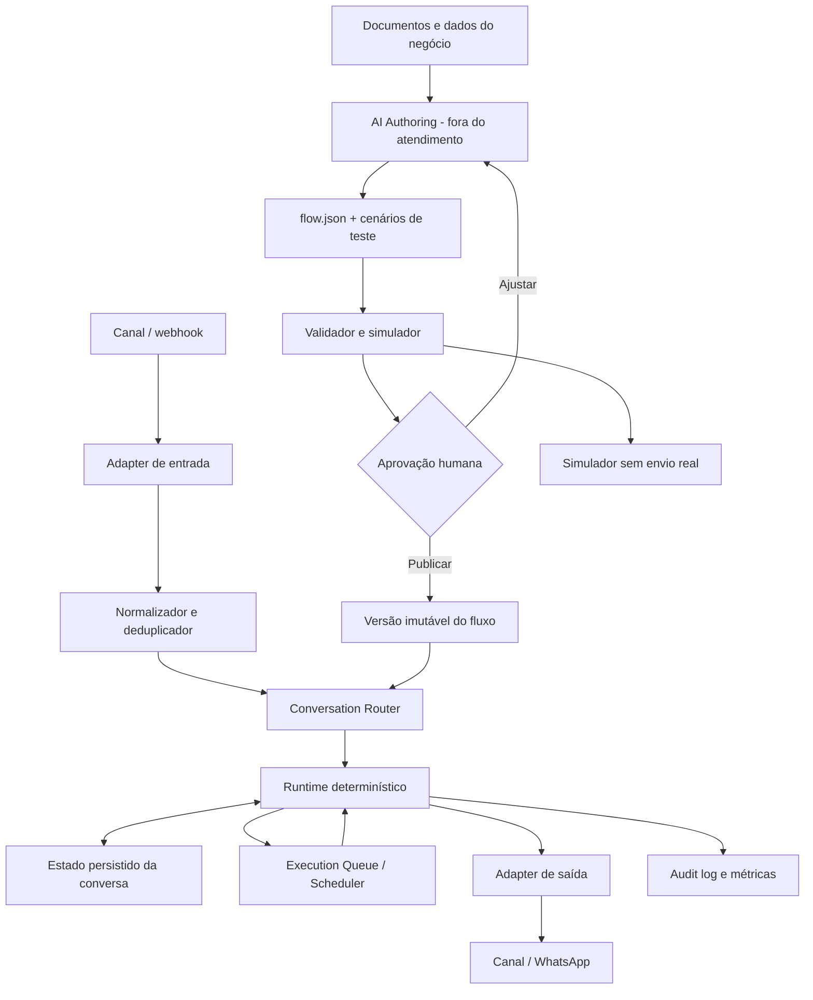

# Arquitetura proposta

## Visão geral

## Camadas

### 1. AI Authoring (não faz parte do runtime)

Ferramentas de IA externas ou uma interface de preparação podem converter material do negócio em um pacote declarativo: mensagens, regras, grafos, variáveis, condições e cenários de teste. Não responderá mensagens dos clientes nem será chamada pelo runtime.

### 2. Flow Definition / DSL

Formato versionado e independente do editor. Um fluxo precisa ser representável por JSON, validável por JSON Schema e legível por humanos. O canvas React Flow deve apenas editar essa definição; não deve ser a fonte definitiva de lógica.

### 3. Compiler / Validator

Valida estrutura, tipos, conexões, referências, placeholders e regras semânticas. Detecta nó inalcançável, saída sem destino, loops sem limite, espera sem timeout, variáveis não definidas, regra ambígua e risco de RegEx. Gera plano executável versionado.

### 4. Runtime determinístico

Recebe evento normalizado, identifica a sessão ativa, processa a entrada com regras determinísticas e avança o grafo. Não importa SDK de LLM, não possui chave de IA e não faz chamadas a modelos.

### 5. Persistência e agendador

Persiste sessões, variáveis, cursor/nó atual, versão do fluxo, entradas recebidas, ações pendentes e prazos. Atrasos são jobs duráveis; não usar `setTimeout` como mecanismo de longo prazo em processos que podem reiniciar.

### 6. Adapters

Contrato comum para entrada/saída de mensagem. Começar com adapter de simulação/teste; WhatsApp será um adapter futuro. Evitar embutir Baileys, Evolution, WAHA ou Meta Cloud API no núcleo do motor.

### 7. Observabilidade

Cada execução deve registrar evento recebido, versão do fluxo, nó avaliado, condição escolhida, ação executada, resultado e duração. Redigir números e conteúdos sensíveis de logs conforme política de retenção.

## Roteamento de mensagens

Ordem recomendada:

1. Validar tenant/workspace, canal e autenticidade do evento.
2. Deduplicar pelo identificador do provedor e criar registro de entrada idempotente.
3. Procurar uma sessão ativa para a chave de conversa.
4. Se a sessão estiver aguardando resposta, entregar a mensagem ao nó de espera atual antes de disparar um fluxo novo.
5. Se não houver sessão ativa, avaliar gatilhos iniciais por prioridade e escopo.
6. Executar o fluxo até uma suspensão (aguardar resposta/tempo), encerramento ou limite seguro de passos por evento.
7. Persistir estado antes de confirmar a conclusão do processamento.

Chave lógica da conversa: `workspace_id + channel_id + provider_account_id + contact_id + thread_id`, com `thread_id` opcional para canais sem thread/grupo.

## Catálogo inicial de nós

**Gatilhos**

- `trigger.message_received`
- `trigger.keyword`
- `trigger.webhook`
- `trigger.schedule` (fase posterior)

**Mensagens**

- `message.text`
- `message.template`
- `message.media` (posterior)
- `message.quick_replies` / `message.menu`

**Lógica**

- `logic.condition`
- `logic.switch`
- `logic.match`
- `logic.random` (determinístico por seed e regras auditáveis)
- `logic.goto`

**Estado e dados**

- `state.wait_for_reply`
- `data.capture`
- `data.set_variable`
- `data.lookup` (por adapter de dados com escopo/allowlist)

**Tempo**

- `time.delay`
- `time.wait_until`
- `time.timeout`

**Ações**

- `action.webhook`
- `action.handoff`
- `action.tag_contact` (se o provider suportar)
- `action.end`

## Estados da conversa

`new -> running -> waiting_input | scheduled -> running -> completed`

Estados terminais/operacionais adicionais: `handed_off`, `cancelled`, `failed`, `expired`. Cada transição precisa de evento, timestamp, motivo e versão do fluxo.

## Dados centrais (modelo lógico)

- `workspace`: fronteira de isolamento e configurações.
- `channel_connection`: credenciais/identificador do adapter, nunca expostas ao editor.
- `flow`: identidade lógica.
- `flow_version`: definição imutável publicada.
- `flow_draft`: versão editável.
- `conversation`: contato/thread e estado atual.
- `conversation_session`: fluxo/versão/nó atual/estado persistido/variáveis.
- `inbound_event`: evento recebido e chave de idempotência.
- `execution`: tentativa de processar um evento.
- `execution_step`: decisões e nós executados.
- `scheduled_job`: atraso/timeout/retry durável.
- `outbound_message`: pedido de envio, status e idempotência.
- `audit_event`: alterações de configuração e publicação.

O esquema físico e tecnologia de banco serão escolhidos após protótipo, não por cópia do SQLite do AutoResponder ou das tabelas de outro projeto.
